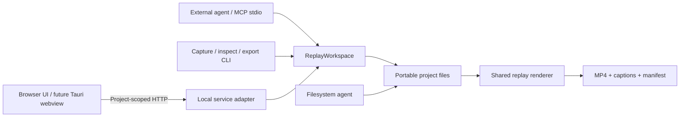

# Studio application architecture

The application is an independent, private Bun workspace. The published DemoHunter CLI remains separate. Browser UI, local service, MCP and CI renderer share the same model and validated filesystem workspace.

## Boundaries implemented now

- **Browser-safe contracts:** contract.ts and model.ts own versions, validation and timeline math. web/ uses HTTP and project-relative URLs; it has no Bun, Node, Tauri or filesystem imports at runtime. Vendor-specific agent configuration is outside the product.
- **Local application service:** ReplayWorkspace handles inspection/mutations; storage.ts handles revision checks, atomic file replacement, locking/history. Format compatibility is checked before reads/edits. Agents can bypass adapters and edit canonical files deliberately.
- **Transport adapters:** server.ts creates a project handler; library-server.ts composes handlers in one HTTP process. Project-scoped resource/API routes keep multiple tabs isolated. Static UI assets are compiled once per service process. MCP binds to one explicit project so opening another tab cannot redirect an in-flight agent write. `studio list` provides JSON discovery across the workspace.
- **Library:** LocalLibrary scans an explicit workspace, skips dependency/cache directories and symlinks, bounds depth/entry count, tolerates damaged captures, and returns relative paths. Routes resolve real paths within that workspace. Posters and scene thumbnails (`/api/frame`) are derived, cached per revision under `.studio/` and rendered through one globally bounded queue. The library links recordings to tours, and reads git status (branch, changed files) without writing. It never runs captures; recording stays in the CLI.
- **Render jobs:** render.ts supplies the same read-only player to PNG and MP4 export. It runs no source app scripts. Export encodes timestamped frames, mixes only current speech, writes captions/checksums, checks source revision throughout, stages results and refuses an existing destination. UI export jobs are process-local; CLI export is the durable CI interface.
- **Activity and review:** disposable operation records bridge separate MCP/service processes without coupling content revision to presence. Heartbeats and terminal states drive reduced-motion-aware presence (title bar, canvas target, timeline, script, note thread). MCP tool calls run inside an author context, so tracked history entries name the agent session; the editor groups them into review turns. User selection/playhead remain independent unless the person opts into Follow agent.
- **Direct editing:** web/element-editor.ts owns selection, pointer gestures and pending patches. element-edit.ts shares patch semantics between browser, HTTP and MCP. web/element-overrides.ts restores and reapplies DOM changes each frame, preserving rrweb text nodes and authored scene state. Scene targets use a source path and selector; geometry uses source pixels. Drafts remain in memory until revision-checked saves succeed.
- **Interface fonts:** Geist, Geist Mono and Literata ship as local packages and are served by the service; no CDN.

## Hosting and desktop path

The browser speaks a project-scoped service API; storage credentials and provider keys stay in the service process. A later hosted deployment can mount tenant-scoped storage and add authorization at the library/project routing boundary, plus background workers for capture/export. The current server has no user authentication: deploy it locally or on a trusted private development network. It is not a multi-tenant hosted product yet. Library scanning and poster generation are deliberately bounded but are not a large-scale search/indexing service.

For Tauri, reuse this frontend and package a local service sidecar; do not move Node filesystem calls into view code. The shell will need per-target service binaries/assets, Playwright/FFmpeg packaging or detection, scoped IPC/shell permissions, launch readiness, shutdown handling, filesystem selection and update/signing work. No Tauri placeholder is presented as a working desktop release. The shared renderer retains Chromium for consistent output even if the desktop webview uses another engine.

Primary research: [Paper MCP](https://paper.design/docs/mcp), [Tauri architecture](https://v2.tauri.app/concept/architecture/), [Tauri sidecars](https://v2.tauri.app/develop/sidecar/), [MCP request progress](https://modelcontextprotocol.io/specification/latest/basic/utilities/progress). Paper documents visible feedback during agent inspection. Studio reports actual tool operations; it cannot observe an agent's private thinking. MCP request progress and the editor's persistent activity feed have different purposes.
