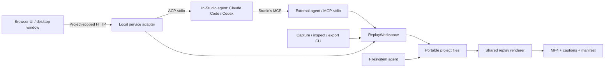

# Studio application architecture

The application is an independent, private Bun workspace. The published DemoHunter CLI remains separate. Browser UI, local service, MCP and CI renderer share the same model and validated filesystem workspace.

## Boundaries implemented now

- **Browser-safe contracts:** contract.ts and model.ts own versions, validation and timeline math. web/ uses HTTP and project-relative URLs; it has no Bun, Node, Electron or filesystem imports at runtime; the optional `window.demohunterDesktop` bridge is feature-detected. Vendor-specific agent configuration is outside the product.
- **Local application service:** ReplayWorkspace handles inspection/mutations; storage.ts handles revision checks, atomic file replacement, locking/history. Format compatibility is checked before reads/edits. Agents can bypass adapters and edit canonical files deliberately.
- **Transport adapters:** server.ts creates a project handler; library-server.ts composes handlers in one HTTP process. Project-scoped resource/API routes keep multiple tabs isolated. Static UI assets are compiled once per service process. The workspace MCP edits the demo open in Studio unless a tool call passes `project`; writes carry the expected revision, so a target that changed underneath an agent fails with a conflict instead of landing in the wrong demo. `studio list` provides JSON discovery across the workspace.
- **Library:** LocalLibrary scans an explicit workspace, skips dependency/cache directories and symlinks, bounds depth/entry count, tolerates damaged captures, and returns relative paths. Routes resolve real paths within that workspace. Posters and scene thumbnails (`/api/frame`) are derived, cached per revision in a private per-user cache outside the project (never written into repositories) and rendered through one globally bounded queue. The library links recordings to tours, and reads git status (branch, changed files) without writing. It never runs captures; recording stays in the CLI.
- **Render jobs:** render.ts supplies the same read-only player to PNG and MP4 export. It runs no source app scripts. Export encodes timestamped frames, mixes only current speech, writes captions/checksums, checks source revision throughout, stages results and refuses an existing destination. UI export jobs are process-local; CLI export is the durable CI interface.
- **Activity and review:** disposable operation records bridge separate MCP/service processes without coupling content revision to presence. Heartbeats and terminal states drive reduced-motion-aware presence (title bar, canvas target, timeline, script, note thread). MCP tool calls run inside an author context, so tracked history entries name the agent session; the editor groups them into review turns. User selection/playhead remain independent unless the person opts into Follow agent.
- **In-Studio agents:** agents.ts starts the person's own coding agent (Claude Code or Codex ACP adapter, run with Studio's Bun runtime) in the demo's worktree, passes Studio's MCP server in `session/new`, and relays messages, plans, tool calls and permission requests to the editor over a per-session event stream (agent-routes.ts, library service only). The agent keeps its own login, model and settings; Studio calls no model and stores no credentials. Studio builds the context preamble (title, time, selection, notes) on the server from project files, so the page cannot inject text as Studio. Read-only DemoHunter tools (their `readOnlyHint`) are approved automatically; everything else asks the person. Model and mode come from the agent's session config options and are set through ACP. terminal.ts opens the same agent, or its own sign-in, in Terminal in the worktree (macOS; elsewhere the command is copied). Folders the desktop app hasn't trusted refuse to start agents. Read-only auto-approval trusts only what the agent reports about the call (Claude Code's tool and MCP server in `_meta`, Codex's MCP tool_call), never a title; modes that stop asking (bypass, full access) are offered but never restored from settings, which a repository could ship. Trusting a folder is trusting its code: its Bun config and `.env`, its scene scripts (same origin as the editor, so they can reach the agent routes too) and the agents run with the person's rights, for the opened folder and the worktrees of its repository.
- **Direct editing:** web/element-editor.ts owns selection, pointer gestures and pending patches. element-edit.ts shares patch semantics between browser, HTTP and MCP. web/element-overrides.ts restores and reapplies DOM changes each frame, preserving rrweb text nodes and authored scene state. Scene targets use a source path and selector; geometry uses source pixels. Drafts remain in memory until revision-checked saves succeed.
- **Interface fonts:** Geist, Geist Mono and Literata ship as local packages and are served by the service; no CDN.

## Hosting and desktop path

The browser speaks a project-scoped service API; storage credentials and provider keys stay in the service process. A later hosted deployment can mount tenant-scoped storage and add authorization at the library/project routing boundary, plus background workers for capture/export. The current server has no user authentication: deploy it locally or on a trusted private development network. It is not a multi-tenant hosted product yet. Library scanning and poster generation are deliberately bounded but are not a large-scale search/indexing service.

The desktop app (apps/desktop, alpha) reuses this frontend unchanged: an Electron shell starts the local service as a child process (its own pinned Bun), waits for its URL, and shows it in a window. The shell owns only folder selection, recent projects, window state and a narrow IPC bridge (choose/open a folder, open or reveal export files inside the opened project); navigation is limited to the shell's app:// pages and the exact Studio origin. The downloadable build bundles the service sources, production modules and Bun; Chromium is fetched once on first launch and FFmpeg is detected on the system. It is signed ad hoc, not notarized, and has no auto-update yet. The shared renderer keeps Chromium for consistent output whatever the window engine.

Primary research: [Paper MCP](https://paper.design/docs/mcp), [Tauri architecture](https://v2.tauri.app/concept/architecture/), [Tauri sidecars](https://v2.tauri.app/develop/sidecar/), [MCP request progress](https://modelcontextprotocol.io/specification/latest/basic/utilities/progress). Paper documents visible feedback during agent inspection. Studio reports actual tool operations; it cannot observe an agent's private thinking. MCP request progress and the editor's persistent activity feed have different purposes.
